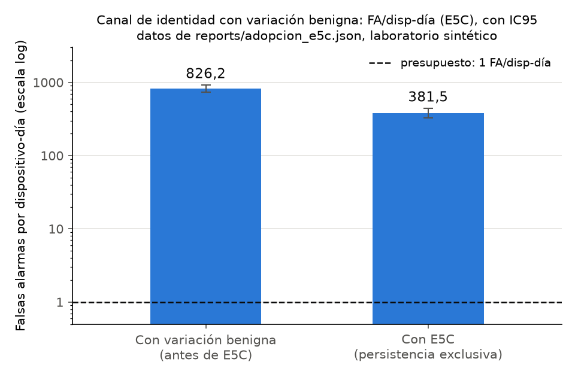

# IDS basado en IA — Huella Digital IEEE 802.3

Prototipo del sistema de detección de intrusiones descrito en el artículo
*"Detección de Intrusiones en Redes TCP/IP mediante Huella Digital de
Dispositivos en el Protocolo IEEE 802.3 usando Inteligencia Artificial"*.

## Arquitectura

```
Captura (Scapy) -> Extracción de huella IEEE 802.3 -> Preprocesamiento
      -> Clasificación (Random Forest / XGBoost) -> Mitigación / Alerta
                              ^
                              |
                    Simulador de ataque de suplantación
```

Cada bloque corresponde a un módulo en `src/`:

| Módulo | Responsabilidad |
|---|---|
| `src/capture.py` | Captura de tráfico en vivo con Scapy (requiere permisos de red) |
| `src/fingerprint.py` | Extracción de la huella digital IEEE 802.3 (MAC, OUI, longitud, timing) |
| `src/data.py` | Carga del dataset real (CICIDS2017/2018) o generación sintética de respaldo |
| `src/preprocess.py` | División train/test y escalado de variables |
| `src/models.py` | Entrenamiento, evaluación y persistencia de Random Forest y XGBoost |
| `src/attack_simulator.py` | Simulación del ataque de suplantación de huella digital |
| `src/pipeline.py` | Orquestador (Algoritmo 1 del artículo): inferencia por trama y experimento completo |

## Uso rápido

```bash
pip install -r requirements.txt
python3 -m src.pipeline
```

Pruebas: `pip install -r requirements.txt -r requirements-dev.txt` y luego `python -m pytest -q`.

Esto ejecuta las Fases 2-4 de la metodología (datos, entrenamiento, evaluación
comparativa y simulación de ataque) y guarda los modelos entrenados en `models/`.

Mientras no se cuente con el dataset real, `src/data.py` genera datos sintéticos
con la misma estructura de columnas, para que el pipeline sea ejecutable de
punta a punta desde ya.

## Pendientes (trazabilidad)

- [ ] Sustituir `data/cicids2017_procesado.csv` (placeholder) por CICIDS2017/2018 real.
- [ ] Ejecutar `src/capture.py` en el laboratorio de la asignatura para obtener huellas digitales reales.
- [ ] Ajuste de hiperparámetros (`GridSearchCV`/`RandomizedSearchCV`).
- [ ] Integrar `src/pipeline.py:inferir` en un bucle de captura en vivo (modo streaming).

## Estructura

```
.
├── src/
│   ├── capture.py
│   ├── fingerprint.py
│   ├── data.py
│   ├── preprocess.py
│   ├── models.py
│   ├── attack_simulator.py
│   └── pipeline.py
├── notebooks/
│   └── IDS_IA_Ciberseguridad_proyecto.ipynb
├── data/              # datasets (no versionados)
├── models/             # modelos entrenados (.joblib, no versionados)
└── requirements.txt
```

## Etapas E1–E7 y cómo reproducir

El proyecto avanzó por etapas, cada una con su informe en `docs/` y sus cifras congeladas en
`reports/`. El cuaderno de cierre las recorre de punta a punta:

```bash
# Cuaderno de cierre (CRISP-DM, OE1–OE3): abrir en Jupyter y ejecutar en orden
jupyter notebook notebooks/cierre_e7.ipynb

# Evaluación supervisada (E2) y de identidad (E3)
.venv/bin/python scripts/evaluar.py --config configs/e2.json
.venv/bin/python scripts/evaluar_identidad.py --config configs/identidad.json --partes b

# Robustez / evasión a nivel de pcap (E4)
.venv/bin/python scripts/evaluar_robustez.py --config configs/robustez.json      # E4R
.venv/bin/python scripts/evaluar_robustez.py --config configs/robustez_e4c.json  # E4C (ARP lento)

# Menos falsas alarmas sin absorber el clon (E5C)
.venv/bin/python scripts/evaluar_adopcion.py --config configs/adopcion_e5c.json

# Captura en streaming (E5): offline (sin root) o en vivo
.venv/bin/python scripts/captura_en_vivo.py --pcap data/pcap/sesion_000.pcap --dataset data/dataset_lab.csv
sudo .venv/bin/python scripts/captura_en_vivo.py --iface eth0 --red-local 10.0.0.0/24 --dataset data/dataset_lab.csv

# Pruebas
.venv/bin/python -m pytest -o addopts="" -q
```

| Etapa | Qué resuelve | Informe |
|---|---|---|
| E1–E2 | Dataset del laboratorio y clasificador por episodio (OE2) | `docs/INFORME_E1.md`, `docs/INFORME_E2.md` |
| E3 | Identidad del dispositivo: perfil de pila y vínculo IP→MAC | `docs/INFORME_E3A.md`, `docs/INFORME_E3B.md` |
| E4 | Evasión a nivel de pcap (OE3): robustez y régimen invisible | `docs/INFORME_E4.md` (+ E4R, E4C) |
| E5 | Captura en streaming en vivo (`src/streaming.py`) | `docs/INFORME_E5.md` |
| E5C | Tercera vía: menos FA con variación benigna sin absorber clones | `docs/INFORME_E5C.md` |
| E6 | Mitigación (dry-run) y pronóstico de alertas (OE3) | `docs/INFORME_E6.md` |
| E7 | Cierre: cuaderno CRISP-DM de punta a punta | `notebooks/cierre_e7.ipynb` |

Estado y conclusiones vigentes: `docs/ESTADO.md`.

## Reproducir desde cero

Comandos exactos, en orden. Cada uno se ejecutó el 2026-11-25 (Python 3.14.9, 4 CPU) salvo los
marcados **no ejecutado**; los tiempos son los medidos. Todo el tráfico es sintético y se escribe a
archivo: nada se emite por ninguna interfaz.

```bash
# 1. Entorno (ejecutado). `uv` en vez de pip global.
uv venv
uv pip install -e ".[dev]"            # ".[dev,notebook]" añade nbconvert/ipykernel para el cuaderno

# 2. Corpus de desarrollo E1–E2: 20 sesiones de 15 min con el generador congelado (ejecutado, 6 min 41 s)
.venv/bin/python scripts/lab/generar_dataset_lab.py --salida data/dataset_lab.csv
sha256sum data/dataset_lab.csv
# esperado y obtenido: 7f06d099477a474b12db73001f3ee56a8e14e93bb41501c8b49ee94e4032a945

# 3. Sesiones de identidad E3 con los rangos ya usados (ejecutado; 1–2,5 min cada uno)
.venv/bin/python scripts/lab/generar_clones.py       --inicio 0 --sesiones 40 --dir-pcap data/pcap_clones
.venv/bin/python scripts/lab/generar_variacion.py    --inicio 0 --sesiones 20 --dir-pcap data/pcap_variacion
.venv/bin/python scripts/lab/generar_suplantacion.py --inicio 0 --sesiones 40 --dir-pcap data/pcap_e3b
.venv/bin/python scripts/lab/generar_contaminacion.py --inicio 0 --sesiones 20 --dir-pcap data/pcap_e3b

# 4. Evaluaciones (NO EJECUTADAS: escriben en reports/, cuyas cifras están congeladas; ver abajo)
.venv/bin/python scripts/evaluar.py --config configs/e2.json                                 # E2
.venv/bin/python scripts/evaluar_identidad.py --config configs/identidad.json --partes a,b   # E3A + E3B
.venv/bin/python scripts/evaluar_robustez.py --config configs/robustez.json                  # E4R
.venv/bin/python scripts/evaluar_robustez.py --config configs/robustez_e4c.json              # E4C
.venv/bin/python scripts/evaluar_adopcion.py --config configs/adopcion_e5c.json              # E5C

# 5. Streaming offline E5 sobre el pcap de demostración (ejecutado, 12 s; entrena el supervisado al arrancar)
.venv/bin/python scripts/captura_en_vivo.py --pcap data/pcap/demo/sesion_demo.pcap \
    --dataset data/dataset_lab.csv --red-local 10.0.0.0/24

# 6. Suite de pruebas (ejecutado, ~5 min)
timeout 900 .venv/bin/python -m pytest -o addopts="" -q

# 7. Cuaderno de cierre, figuras y pcap de demostración (ejecutado; segundos cada uno)
.venv/bin/jupyter nbconvert --to notebook --execute --inplace notebooks/cierre_e7.ipynb
.venv/bin/python scripts/figuras.py
.venv/bin/python scripts/generar_demo_pcap.py      # regenera data/pcap/demo/ (mismo sha256)
.venv/bin/python scripts/verificar_demo_pcap.py
.venv/bin/python scripts/pcap_to_features.py --pcap data/pcap/demo/sesion_demo.pcap --salida /tmp/demo_ventanas.csv
```

Por qué no se ejecutaron las evaluaciones del paso 4: sus `configs/` fijan la salida en
`reports/*.json`, y `reports/` es la evidencia congelada del informe (ninguna se reentrena en la
entrega). Para rehacer una, copia su config cambiando `salida` a otra ruta. Los generadores del
paso 3 corrieron sin error, pero `reports/` no guarda un sha256 de esos pcaps, así que su identidad
byte a byte con los de E3 no se pudo comprobar. El corpus del paso 2 sí: el sha256 coincide.

## Figuras y pcap de demostración

- `docs/figuras/recall_por_intensidad.png`: recall del supervisado por intensidad (media 0,935 /
  suave 0,891 / ráfaga 0,824, con IC95). Datos: `reports/robustez_e4.json`.
- `docs/figuras/fa_disp_dia.png`: FA/disp-día del canal de identidad con variación benigna, 826 →
  382 con E5C, frente al presupuesto de 1 FA/disp-día (escala log). Datos: `reports/adopcion_e5c.json`.
- Las dos se regeneran desde cero con `scripts/figuras.py`, que solo lee `reports/`.
- `data/pcap/demo/sesion_demo.pcap` (4,29 MB, 150 s): **tráfico sintético de laboratorio, generado
  por `scripts/lab/generar_trafico.py` con semilla fija; no es una captura de red real**. Trae un
  episodio de ARP spoofing y un clon de MAC (este último de `generar_clones.py`). Qué contiene, cómo
  abrirlo en Wireshark y qué columna sale de cada campo: [`docs/PCAP_DEMO.md`](docs/PCAP_DEMO.md).




## Contexto académico

Detección de intrusiones en red con aprendizaje automático: captura de tráfico, ventanas de tiempo, modelo XGBoost y una capa de identidad por dispositivo. Trabajo de la asignatura **Fundamentos de redes de comunicaciones** de Ingeniería de Sistemas (Universidad Distrital Francisco José de Caldas),
con el docente **Octavio José Salcedo Parra**.
